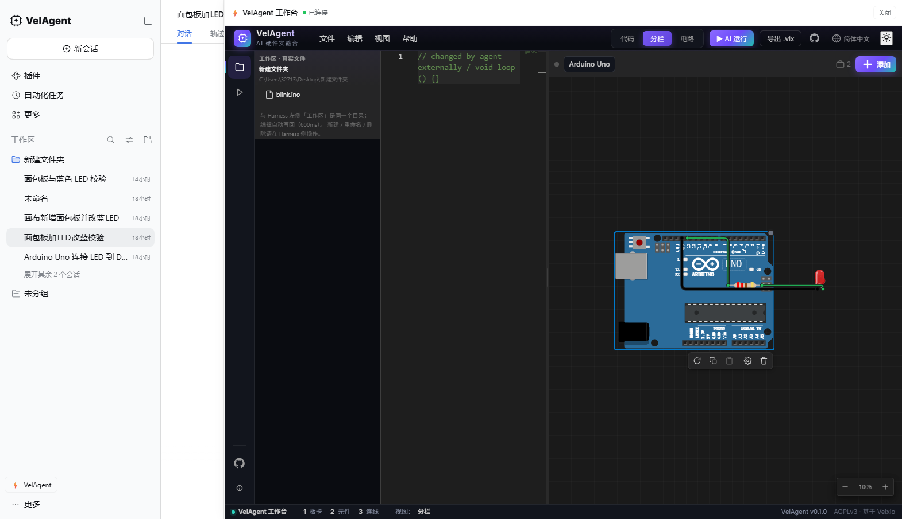
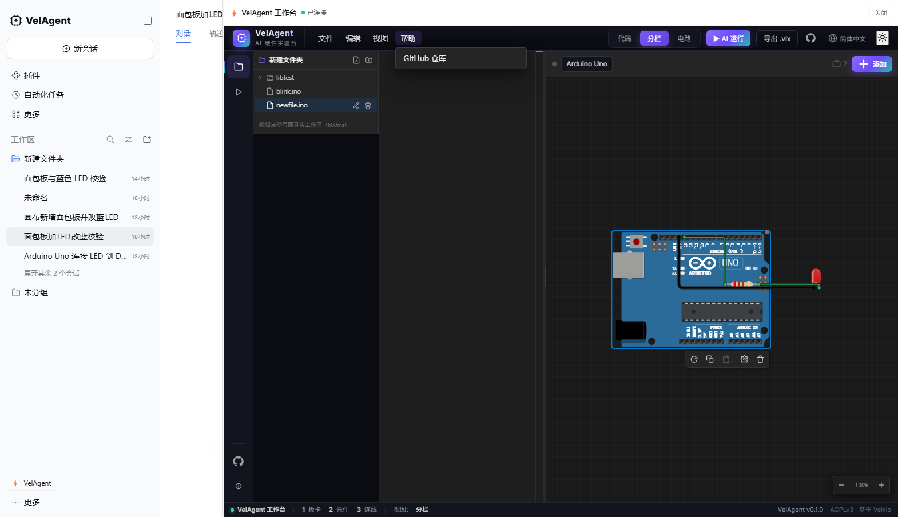
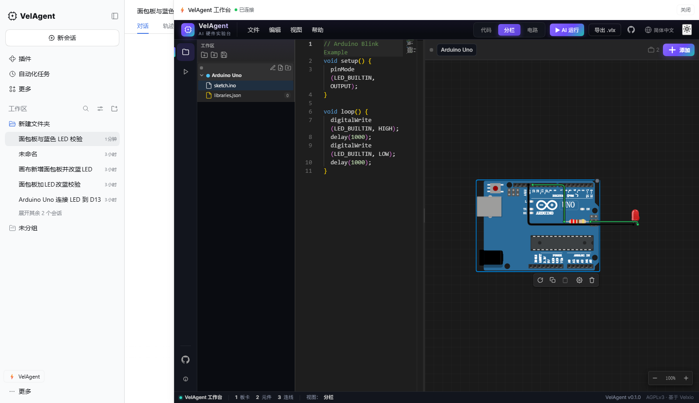

> **历史/背景文档**：部分内容描述迁移前的架构（Tauri 主导、资产复制进 public 等）。
> 当前架构以 [gaiZao/README.md](../README.md) 与 [2026-11-13-migration.md](./2026-11-13-migration.md) 为准。

# 深度集成：VelAgent 画布 × DeepSeek Harness

> **架构现状（2026-11-13 迁移）**：本仓库已是官方 Harness 的 fork（`master` 官方镜像 / `dev` 工作分支），
> 全部改造收在 `gaiZao/`，插件以 **bundle** 形式用 `dsh plugin --profile web add` 安装；
> UI 资产由插件宿主的 `webServer` 路由从 `gaiZao/features/velagent-ui/embed-dist` 发出，不再复制进
> `apps/web/public`。启动：`gaiZao/scripts/install-velagent.ps1` 后运行 `velagent`。

本文说明 VelAgent 是如何「长进」DeepSeek Harness 里的：为什么不是 iframe / 独立窗口，
模型如何实时读写画布，以及构建、运行、验收方法。

## 1. 产品形态

```
VelAgent（品牌化 DeepSeek Harness）
├─ 会话 / 聊天 / 工具 / 设置 / 模型接入   ← Harness 原生能力（MIT，见 LICENSE_NOTICE/deepseekharness/）
├─ ui-velagent 内置插件
│  ├─ 宿主半边：画布状态中心 + 工作区文件桥 + velagent_* 工具 + system prompt 段落
│  └─ 浏览器半边：右侧可伸缩面板，原生挂载**原始 VelAgent 工作台**
│     （品牌头 / 文件·编辑·视图·帮助菜单 / 活动栏 / **真实工作区文件树** / 代码+画布分栏 / AI 运行 / 导出 .vlx / 状态栏）
└─ 工作台前端                              ← Velxio 衍生（AGPLv3，见 LICENSE_NOTICE/velxio/）
```

- **不是** iframe、**不是**独立窗口、**不是**覆盖在 Harness 上的浮层，而是 Harness React 树里的一块原生面板；
- **不需要**单独端口、Token、MCP、AI Key 配置——画布插件复用 Harness 自己的模型凭证与 web server；
- 独立版 Tauri 桌面端（`gaiZao/tauri/` + `gaiZao/features/velagent-ui/`）继续保留，作为没有 Harness 时的备用形态。

## 1.1 单应用启动

对外只有一个入口：`start.cmd` / `start.ps1` 启动**一个** Harness 进程（端口 2021），
浏览器打开后所有能力都在同一个页面里（对话 + 画布 + 代码 + 试运行）。
如果 2021 已在运行，脚本只打开页面，不会重复启动。原来的 `vite preview`（2023）、
独立 Tauri 窗口都不再是主链路。

## 2. 数据流

```
用户/模型
   │  velagent_* 工具（Cordis tools，全局注册）
   ▼
CanvasHub（宿主进程） ── 命令队列 / 长轮询 / ack ──► canvasSync（浏览器）
   ▲                                                   │
   └────────── 快照 POST（revision 单调） ◄─────────────┘
                                                       │ window.VelAgentEmbed
                                                       ▼
                                               VelAgent 电路画布（React，原生 DOM）
```

1. dock 打开 → 加载 `/velagent-assets/velxio-ui.css` + `/velagent-assets/velagent-embed.js`（插件宿主静态路由）→ `mount(container)`；
2. 画布任何变化 → 100ms 去抖 → `POST /velagent/canvas/snapshot`（宿主内存里更新最新电路）；
3. 模型调用 `velagent_*` 工具 → 宿主把命令放进该会话队列 → 浏览器长轮询取到 → `executeCommand` 执行 → ack；
4. 工具把 ack 结果作为结构化 JSON 返回给模型；画布 UI 立即反映修改。

协议细节（HTTP 字段、命令格式、失败语义）见 [canvas-bridge-contract.md](canvas-bridge-contract.md)。

## 2.1 工作区是同一个（与 Harness 左侧工作区共用目录）

工作台的文件树不再使用内置虚拟文件（Arduino Uno / libraries.json），而是直接映射**当前会话的
Harness 工作区目录**（Session header 的 cwd）：

- 打开工作台时调用宿主 `GET /velagent/workspace/list` 列出真实目录，`GET .../read` 载入文件；
  文件树**只显示工作区文件夹本身的名字**（例如 `新建文件夹`），不显示"工作区"标题或完整路径；
- 编辑器停止输入 600ms 后自动 `POST /velagent/workspace/write` 写回磁盘；
- 每 2 秒 + 窗口 focus 时对比 version 刷新：Agent 或外部编辑器改动同一个文件后，工作台
  ≤2s 自动重载；
- 宿主路由把路径限制在会话工作区根目录内（`path escapes the workspace root` 拒绝越界），
  写盘走会话的 sandbox 策略；
- 文件树是 VSCode 式操作：头部「新建文件 / 新建文件夹」按钮、行内 hover 「重命名 / 删除」（目录可展开）；
  新建/重命名/删除分别走 `POST /velagent/workspace/{write,mkdir,rename,delete}`，和磁盘实时一致；
- 「帮助」菜单只保留 **GitHub 仓库** 一项；
- 从侧栏底部（无 session）打开时不传 provider，回退内置文件树。

实测（2026-11-13 08:5x）：工作台文件树显示 `新建文件夹 / C:\\Users\\...\\新建文件夹 / blink.ino`，
与 Harness 左侧「工作区」一致；在 Monaco 改一行 → 磁盘文件 2s 内变化；外部改文件 → 编辑器 4s 内刷新。



文件树 VSCode 化（纯文件夹名 + 新建/重命名/删除，帮助菜单只剩 GitHub）：



## 3. 模型可用的工具

| 工具 | 作用 |
| --- | --- |
| `velagent_read_circuit` | 读当前画布（默认精简：id/ref/坐标 + 计数；`full:true` 返回完整属性） |
| `velagent_place_board` | 放置开发板（如 `arduino-uno`），返回 `ref` 与真实引脚名 |
| `velagent_place_component` | 放置元件（如 `led`、`resistor`、`breadboard`，可 `seat_on` 面包板孔），返回 `ref` 与引脚 |
| `velagent_update_component` | 移动 / 旋转 / 改属性（`id` 或 `ref`） |
| `velagent_remove_component` | 删除元件（`id` 或 `ref`） |
| `velagent_connect` | 连线（`from/to` = `{owner_id 或 ref, pin}`）；引脚不存在会被拒绝并返回可用引脚 |
| `velagent_remove_wire` | 删除连线 |
| `velagent_validate` | 电路校验（errors / warnings；新增 `UNKNOWN_PIN` 引脚不存在错误） |
| `velagent_highlight` | 高亮元件/引脚并显示说明 |
| `velagent_clear` | 清空画布 |
| `velagent_list_components` | 型号目录：板卡列表 + 元件列表（含参数名） |
| `velagent_read_pins` | 某个元件的真实引脚名（面包板给孔位命名规则） |
| `velagent_read_circuit_json` | 读电路 JSON（与 JSON 页签同一份文档） |
| `velagent_apply_circuit_json` | 用电路 JSON 整份替换画布（校验失败画布不变） |
| `velagent_read_code` | 读 dock 里代码编辑器的全部文件（含活动文件） |
| `velagent_write_code` | 改写/新建代码文件（模型可直接生成固件） |
| `velagent_play_timeline` | 把预测的运行时间轴（LED/串口）在画布上播放出来 |
| `velagent_stop_timeline` | 停止播放 |

此外注入一段 system prompt（`velagent:circuit-canvas`），告诉模型：画布在右侧、先读后改、未连接时请用户打开面板；
并要求它只连真实存在的引脚、需要时先读 `velagent_read_pins` / `velagent_list_components`。

## 3.1 电路 JSON 页签（人机共创）

工具条（代码 / 分栏 / 电路 之后）新增 **JSON** 页签，展示当前画布的电路 JSON：

- 人可以直接编辑 JSON，点「应用到画布」生效；有未应用编辑时按钮才可用；
- AI 用画布工具改动后，页签在没有未应用编辑时自动同步；
- AI 也能通过 `velagent_read_circuit_json` / `velagent_apply_circuit_json` 读、改同一份文档；
- 格式见 [canvas-bridge-contract.md](./canvas-bridge-contract.md) §4.1（中文键、平铺元件表 + 连线表、
  `编号.引脚` 引用、面包板孔用 `a5` 这种用户坐标）。

实现：`gaiZao/features/velagent-ui/src/integration/circuitJson.ts`（转换/校验/导入导出）、
`gaiZao/features/velagent-ui/src/components/editor/CircuitJsonPanel.tsx`（页签面板）。

## 4. 构建与运行

前置：Node ≥ 24.9、pnpm、Windows（macOS/Linux 同理）。

```powershell
# 一次：装依赖（改过 package.json 后都要）
cd deepseek-harness
pnpm install --no-frozen-lockfile

# 构建画布 embed（VelAgent 仓库侧）
cd ..\VelAgent\frontend
pnpm build:embed            # 产出 embed-dist/（由插件宿主路由发出，不再复制到 apps/web/public）

# 构建 Harness 产物（含插件 client bundle 与 Web dist）
cd ..\..\deepseek-harness
$env:CI='1'; $env:DSH_CLIENT_COMMIT_HASH='0000000'; $env:DSH_CLIENT_TITLE='VelAgent'
pnpm build:artifacts

# 启动（隔离数据目录，端口 2021）
$env:DSH_HOME = "$env:APPDATA\Enrui\VelAgent\data\harness-home"
$env:DSH_AGENTS_HOME = "$env:DSH_HOME\agents"
node apps/cli/lib/bin.js --profile web --port 2021 --no-open
```

打开终端输出的 `http://127.0.0.1:2021/?token=...`，点右上角/左下角 **VelAgent 电路** 即可打开画布。

模型凭证复用 Harness 现有配置（设置页 / 账号登录 / 环境变量 `DEEPSEEK_API_KEY`），
插件本身不读取、不保存任何 Key。

## 5. 验收

```powershell
# 协议 + 静态产物自检
cd VelAgent
node scripts/verify-canvas-bridge.mjs http://127.0.0.1:2021

# 真实浏览器端到端（Edge headless + CDP，截图存 docs/）
node scripts/gui-smoke.mjs "http://127.0.0.1:2021/?token=<token>"
```

插件单测（宿主半边 11 个用例，真实 WebServer + Tools + apply）：

```powershell
cd deepseek-harness
pnpm exec vitest run packages/client/ui-velagent/tests/canvas-hub.host.spec.ts
```

工作台页签（电路 / 代码 / 运行）自检：

```powershell
node gaiZao/scripts/verify-canvas-bridge.mjs http://127.0.0.1:2021
node gaiZao/scripts/verify-workspace-airun.mjs "http://127.0.0.1:2021/?token=<token>"
```

实测截图（2026-11-12）：

- 画布 dock 与对话并排：[debug-integration-02-dock.png](debug-integration-02-dock.png)
- Agent 调用 `velagent_read_circuit` / `velagent_place_component` / `velagent_update_component`：[debug-integration-03-agent.png](debug-integration-03-agent.png)
- dock 页签「电路 / 代码 / 运行」：[debug-workspace-02-code.png](debug-workspace-02-code.png)、[debug-workspace-03-run.png](debug-workspace-03-run.png)
- 「试运行」按钮触发 Harness Agent 读取电路+代码并播放时间轴：[debug-workspace-06-trial.png](debug-workspace-06-trial.png)

工作台整体嵌入与 AI 运行实测（2026-11-12 18:2x）：

- dock 尺寸 1180×905，工作台元素齐全：品牌头、文件/编辑/视图/帮助菜单、活动栏（含 GitHub）、文件树
  （Arduino Uno / sketch.ino / libraries.json）、Monaco 代码编辑器、电路画布、底部状态栏；
- 点工作台里的 **AI 运行** → 经 Harness AI 执行（不是本地规则）：宿主在 7 秒内收到
  `velagent_read_circuit` / `velagent_read_code` / `velagent_play_timeline` 的 op 与 ack，
  画布 LED 按预测时间轴点亮/熄灭。




实测「试运行」一轮（2026-11-12 17:33，DeepSeek-V4.1-Flash）：

```
[试运行] → Harness Agent 自动执行：
  工具调用 velagent_read_circuit · {"full": true}
  工具调用 velagent_read_code · {}
  工具调用 velagent_play_timeline · <Blink 时间轴，durationMs 6000>
→ 画布 LED 按 1 秒亮 / 1 秒灭播放，串口无输出；对话框给出中文解释。
```

### 常见排错

- **对话回合立刻失败，报 `working-directory: directory does not exist`**：该会话绑定的工作目录被删除/改名了。
  恢复该目录，或在输入框左侧的工作区选择器里换到存在的目录即可；工作目录缺失时模型不会运行，画布工具自然也不会被调用。
- **「试运行」按钮是灰的**：需要从会话内（右上角/会话头的 `⚡ VelAgent 电路`）打开 dock；侧栏底部的全局按钮没有会话上下文。
- **代码页签空白**：embed 需为 v2（`window.VelAgentEmbed.version === 2`）；旧产物只支持电路画布。

## 6. 当前边界（还没做的）

| 项目 | 状态 |
| --- | --- |
| 模型凭证 | ✅ 完全复用 Harness（插件零配置） |
| 画布实时同步 / 工具 | ✅ 已打通（读 + 写 + 校验 + 高亮 + 清空） |
| 变量名（ref）| ✅ 每块板卡 / 元件自动分配 `U1/R1/D1/B1`，工具参数与 JSON 都用它 |
| 引脚校验 | ✅ `connect` 拒绝不存在的引脚并返回可用列表；`validate` 报 `UNKNOWN_PIN` |
| 电路 JSON 页签（人机共创） | ✅ 画布 ⇄ JSON 双向同步，人改点应用、AI 读写同一份文档；导入原子、失败回滚 |
| 面包板吸附 | ✅ `seat_on` 与 JSON `插在` 会按真实引脚几何对齐孔位；导出反映实际吸附 |
| 原生 UI（dock / 主题 token / i18n / 状态） | ✅ 已做 |
| 独立版 Tauri | ✅ 保留 |
| 原始工作台并入右侧面板 | ✅ 品牌头/菜单/活动栏/文件树/代码+画布/状态栏原样嵌入，宽 1180 可拖拽 |
| Code 编辑器 | ✅ 工作台内置 Monaco（同源 `/monaco/vs`） |
| AI 运行（调用 Harness AI） | ✅ 工作台「AI 运行」→ 向会话注入 prompt，Harness 模型调用 velagent_* 工具完成分析/播放 |
| 导出 .vlx 项目 | ✅ 运行页签「导出 .vlx」（embed `exportProject`） |
| 工作区文件与 Harness 共用 | ✅ 文件树/读写直接映射会话工作区目录（同一份文件） |
| 工程文件（电路快照存 workspace、跨会话恢复） | ⏳ 画布快照仍在宿主内存；工作区代码已落盘 |
| 桌面安装包（Electron/Tauri 内置 Harness + 插件） | ⏳ 待打包链路 |
| 画布写操作的审批流（接 Harness approval） | ⏳ 目前直接执行，靠模型/用户对话约束 |
| 命令面板 / 斜杠命令打开画布 | ⏳ 目前用 dock 按钮 |
| 串口/时间轴的独立展示面板 | ⏳ 时间轴已能驱动 LED，串口文本暂时只进 store |
